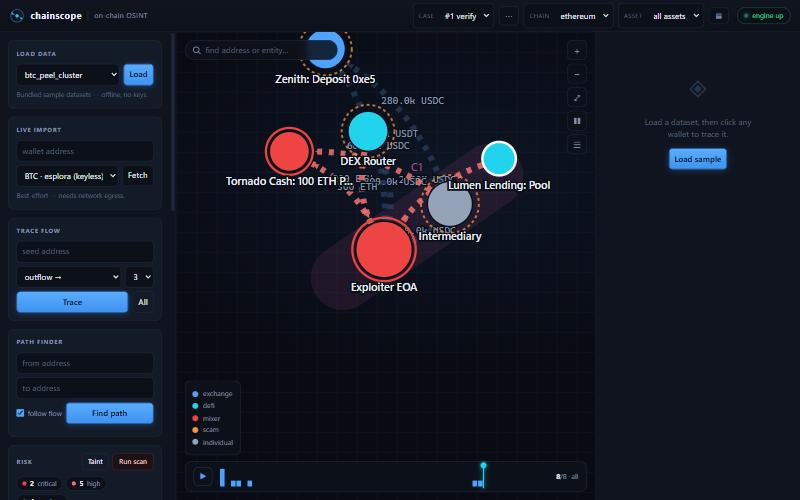
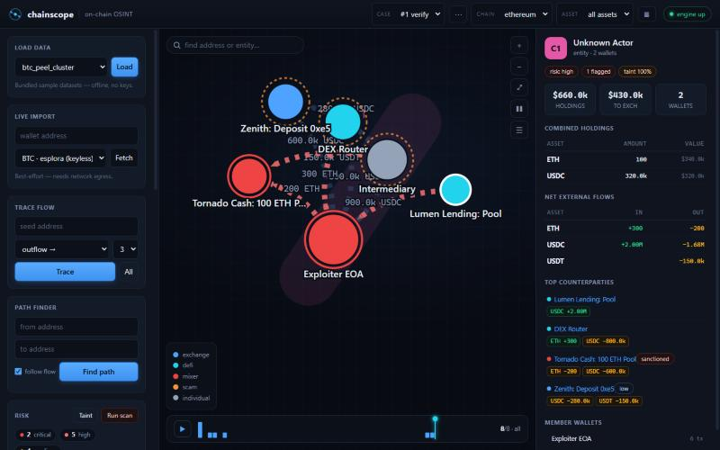
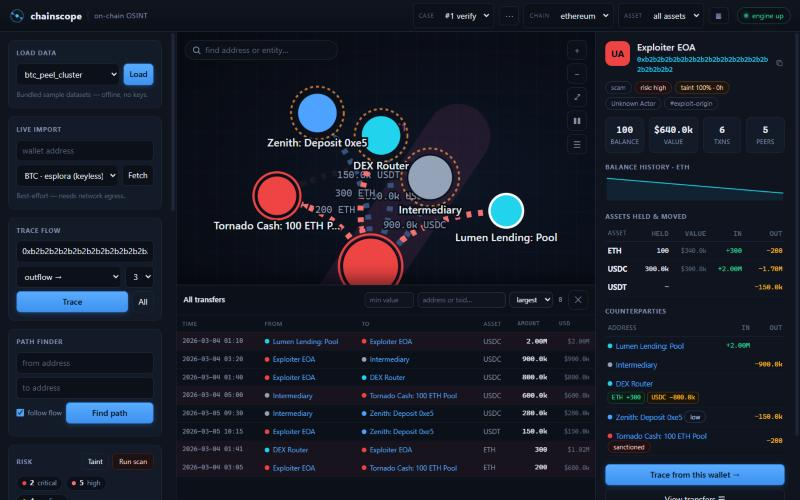

# Chainscope

[](https://github.com/nirry-dev/chainscope/actions/workflows/ci.yml)
[](LICENSE)


A blockchain **transaction & wallet analyzer / visualizer** — an on-chain OSINT
and fund-tracing tool. It inspects *public* transaction history and turns it
into a readable entity graph: wallets and contracts become nodes, value
movements become edges. You can attribute known addresses, follow the money
across hops, cluster co-owned wallets into entities, value holdings in USD, and
flag risky exposure (mixers, sanctioned addresses, tainted inflows).

It is **read-only**. Nothing here signs, broadcasts, or moves funds — this is
the tracing / attribution / visualization layer only, for **authorized**
investigations, incident response, and research. See
[Responsible use](#responsible-use).

Pure Python **standard library** + a **buildless** vanilla-JS front end. No
third-party packages, no build step. Runs offline out of the box.



## Highlights

**Visualize**
- **Interactive flow graph** — a force-directed visualization (SVG + vanilla
  JS). Nodes are colored by entity category and sized by volume; curved edges
  are weighted by value and point in the direction funds moved; flows into
  flagged destinations are drawn in red.
- **Wallet inspector** — balance, USD value, transaction count, counterparties
  (with per-asset nets), assets held & moved, a **balance-history sparkline**,
  and entity attribution for any address.
- **Timeline scrubber** — replay a case over time; the network grows as the
  cursor advances.
- **Search, focus-dimming, pan/zoom/drag, freeze** — standard graph controls.

**Investigate**
- **Follow-the-money tracing** — breadth-first flow trace from a seed address,
  outward, inward, or both, to a chosen hop depth.
- **Path finder** — shortest connecting path between two addresses (directed by
  fund flow, or undirected).
- **Taint propagation** — decaying 0–1 exposure pushed downstream from every
  flagged source, so indirectly-tainted wallets surface too.
- **Address clustering** — groups co-owned wallets into **entities** by
  common-input co-spend and shared-entity attribution; drawn as hulls on the
  graph with an **entity rollup dashboard** (combined holdings, net external
  flows, exchange usage, counterparties).
- **Transfers feed** — a filterable transaction list (scope to a wallet with
  in/out direction, filter by asset / minimum value / address or txid, sort by
  time or value).

**Attribute & assess**
- **Known-entity attribution** — a built-in label KB (exchanges, mixers,
  sanctioned addresses, token contracts) plus **manual annotation** of any
  wallet (label, entity, category, risk, tags, notes).
- **Risk engine** — flags laundering signals (outflow to a mixer/sanctioned
  address) and tainted inflows, with stable de-duplication across re-scans.
  Each flag can be **triaged** — confirmed or dismissed as a false positive
  (dismissed flags drop out of the severity counts).
- **Multi-asset / ERC-20** — per-asset flows, holdings, and a **token
  dashboard** (top holders, top receivers/senders, net exchange flow).
- **USD valuation** — an optional per-case price snapshot values holdings and
  flows throughout the UI and the report.

**Work with it**
- **Saved investigations** — many cases in one local database; rename, annotate,
  delete, switch.
- **Evidence report** — export a case as Markdown (with an embedded Mermaid flow
  diagram) or JSON.
- **Offline-first** — ships sample datasets, so the whole app is demoable with
  no network and no API keys; optional live import from public explorers.
- **Desktop app** — a packaged Tauri build is available (see
  [BUILD-DESKTOP.md](BUILD-DESKTOP.md)).

## Screenshots

| Entity rollup dashboard | Transfers feed + inspector |
| --- | --- |
|  |  |

## Architecture

```
chainscope/
  db.py        SQLite: cases + addresses + transfers + holdings + flags
               + cospends + prices
  store.py     idempotent upserts, aggregated edges, holdings, prices,
               clusters, flag records
  labels.py    built-in known-entity attribution KB + resolver
  sources.py   normalized datasets: bundled samples + live esplora / EVM fetch
  analyze.py   ingest, metrics, tracing, taint, clustering, entity & token
               dashboards, transfers feed, risk engine
  report.py    Markdown / JSON evidence export (+ Mermaid flow diagram)
  cli.py       command-line interface
  samples/     bundled demo datasets
api.py         one stdlib process: JSON API (/api/*) + static UI
ui/            buildless web app (index.html / app.js / styles.css)
demo.py        offline end-to-end demo
tests/         pytest suite (pure, offline)
```

The on-chain graph is the single source of truth: imports write into it,
analysis reads from it. The graph model is intentionally self-contained so it
can later be offered as an addon to a larger security platform.

## Requirements

Python **3.8+**. No third-party dependencies for the core app (the optional test
suite uses `pytest`). The desktop build additionally needs Rust/Tauri and
PyInstaller — see [BUILD-DESKTOP.md](BUILD-DESKTOP.md).

## Run

Start the app (serves the API and the UI from one process):

```bash
python api.py
```

Then open <http://127.0.0.1:8799>, click **Load** to import a sample dataset,
**Run scan** for risk flags, **Detect** clusters, and click any node to inspect
it. The server binds to `127.0.0.1` only.

### CLI

```bash
python -m chainscope.cli case-create "Theft trace"
python -m chainscope.cli import 1 --sample eth_theft_trace
python -m chainscope.cli trace 1 0x1111111111111111111111111111111111111111 --hops 3
python -m chainscope.cli risk 1
python -m chainscope.cli flags 1
```

### Offline demo

```bash
python demo.py
```

### Tests

```bash
pip install pytest
pytest
```

## Live import (optional)

By default everything runs offline from the bundled samples. Live import pulls a
real address's recent transactions from a public explorer:

- **Bitcoin** — keyless, via a Blockstream/esplora REST endpoint. Verified
  against live mainnet.
- **EVM** — via an Etherscan-compatible endpoint; requires an API base URL and
  key you supply. Pulls **both native ETH and ERC-20 token transfers** (valued
  per each token's own decimals and symbol), merged into one dataset.

Live import is best-effort and depends on network egress. It only reads public
data. BTC edges run from a representative input (the first input address) to
each output, and the full input set is recorded as a common-input group for
clustering.

## Dataset format

Custom datasets (CLI `import --file`, or API `source: "dataset"`) are normalized
to this shape; every field except `transfers` is optional:

```jsonc
{
  "chain": "eth",                 // eth | btc | ...
  "asset": "ETH",                 // native asset symbol
  "prices": { "ETH": 3400, "USDC": 1 },        // optional USD snapshot
  "entities": [                   // known-address labels
    { "address": "0x…", "label": "NovaEx Hot", "entity": "NovaEx",
      "category": "exchange", "risk": "low" }
  ],
  "addresses": [                  // balances / seeds / tags / per-asset holdings
    { "address": "0x…", "balance": 100, "seed": true, "tags": ["victim"],
      "holdings": { "USDC": 3000000 } }
  ],
  "transfers": [                  // the value-movement edges (required)
    { "txid": "0x…", "src": "0x…", "dst": "0x…", "value": 12.5,
      "asset": "ETH", "ts": "2026-03-04T01:10:00Z", "block": 2100001 }
  ],
  "cospends": [ ["addr1", "addr2"] ]            // common-input ownership groups
}
```

The bundled samples are synthetic. See
[`chainscope/samples/`](chainscope/samples/).

## Desktop app

A packaged desktop build (Tauri v2 shell + a frozen Python engine sidecar, with
a per-user writable database) is available — see
[BUILD-DESKTOP.md](BUILD-DESKTOP.md).

## Responsible use

Chainscope is for **lawful, authorized** blockchain analysis — incident
response, compliance, research, and investigations you are permitted to conduct.
It analyzes only public on-chain data and never transacts.

- The bundled datasets are **synthetic**. The only real addresses are
  publicly-documented reference points — notably an OFAC-sanctioned Tornado Cash
  pool — included solely to demonstrate attribution against known entities.
- Attributions and risk flags are heuristic signals to guide an investigation,
  **not** proof of wrongdoing or legal/financial advice. Verify before acting.
- Respect the terms of any explorer or data source you point live import at, and
  applicable law and sanctions in your jurisdiction.

To report a security issue, see [SECURITY.md](SECURITY.md).

## Status

Early but functional. The core analysis is covered by an offline test suite and
an end-to-end demo. Live EVM import depends on a user-supplied explorer key;
the BTC path is verified against live mainnet.

See [CHANGELOG.md](CHANGELOG.md) for the release history and
[CONTRIBUTING.md](CONTRIBUTING.md) to get involved.

## License

MIT — see [LICENSE](LICENSE).
